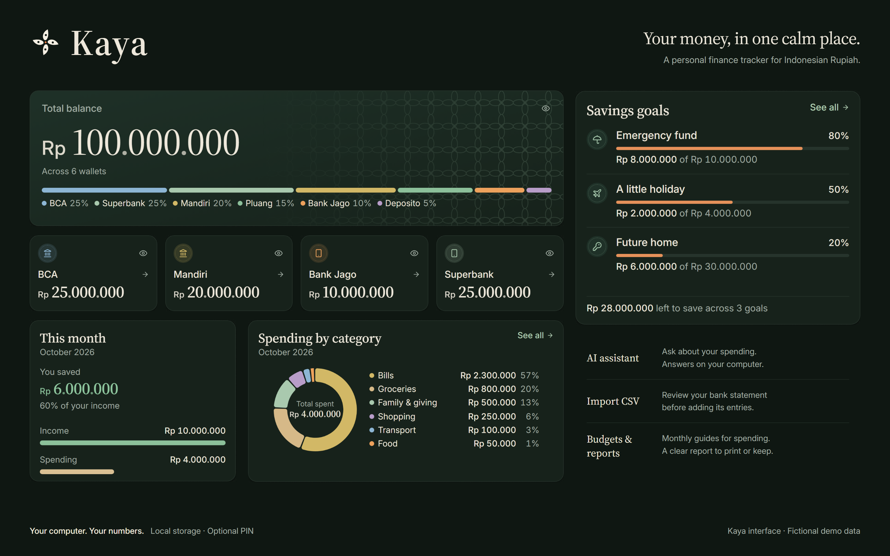
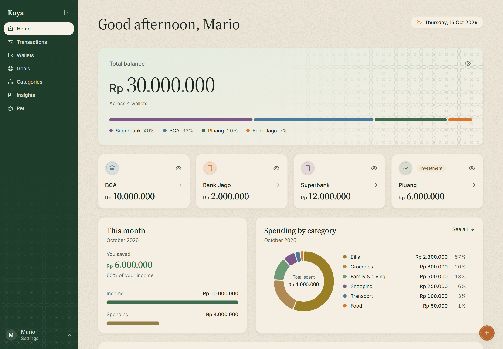
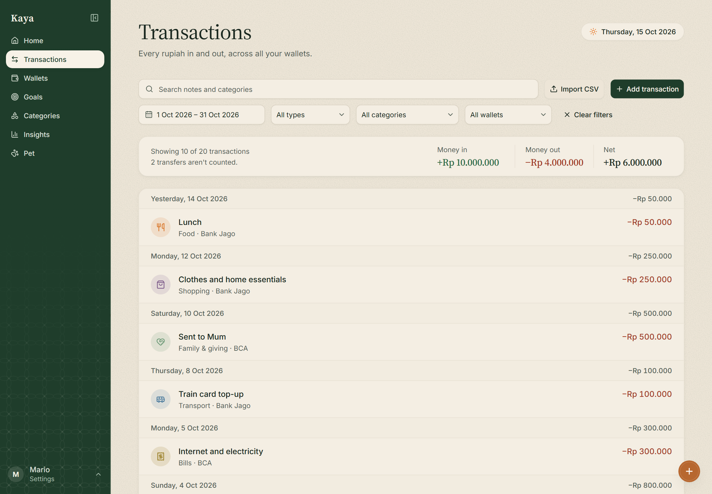

**[Watch the 38-second demo](docs/portfolio/kaya-demo.mp4)**

<details>
<summary>Explore the screenshots</summary>

| Home | Transactions |
| --- | --- |
|  |  |

[Wallets](docs/portfolio/screenshots/wallets.png) / [Goals](docs/portfolio/screenshots/goals.png) / [Insights](docs/portfolio/screenshots/insights.png) / [Dark mode](docs/portfolio/screenshots/home-dark.png) / [Mobile](docs/portfolio/screenshots/mobile.png)

</details>

*All balances and transactions shown in the media are fictional.*

# Kaya

**Your money, in one calm place.**

Kaya is a personal finance tracker for Indonesian Rupiah. See what you have across wallets, understand where it goes, and save toward something that matters. Built for one owner, it runs on your computer and stores your data locally. No bank connection or online account needed.

## Core modules

| Module | What you can do |
| --- | --- |
| **Wallets** | Track bank accounts, cash, e-wallets, investments and depositos. |
| **Transactions** | Record income, expenses and transfers; use quick add or review a bank CSV before importing. |
| **Savings goals** | Set targets, add money and follow your progress. |
| **Categories & budgets** | Organise spending and set monthly guides for each category or the whole month. |
| **Insights** | Explore spending, compare months, review the year and export CSV or printable reports. |

Light and dark themes, a phone layout, optional PIN protection and manual backups round out everyday use.

## Tech stack

- **Frontend:** Next.js 16, React, TypeScript, Tailwind CSS 4, shadcn/ui and Recharts.
- **Backend:** Hono on Node.js 24, with SQLite for local storage.

## Design philosophy

Calm over alarm. Clear amounts, quiet language and budgets that guide without scolding. Forest green, warm cream and generous serif numbers give Kaya its character; Indonesian batik patterns and a clay piggy bank bring a little familiarity and play.

## Get started

Install **Node.js 24** and npm, then run:

```sh
git clone https://github.com/mawrioo/Kaya.git
cd Kaya
npm install
npm run dev
```

Open **http://localhost:3000**. The first run creates sample data; later runs keep your changes in `backend/data/nabungbego.db`.

For phone access, backups, CSV imports and development commands, see the [usage guide](docs/USAGE.md).

## Roadmap

The core tracker is built. Planned next: a **local AI assistant** for questions about your spending and savings. Automatic backups and recurring transactions are also under consideration.

See the [detailed roadmap](ROADMAP.md) for progress and open decisions.

## More about this project

Kaya is a personal project built around everyday money habits in Indonesia, with local storage and a calmer way to read the numbers.

[Product notes](PRODUCT.md) / [Design system](DESIGN.md) / [Usage guide](docs/USAGE.md)
